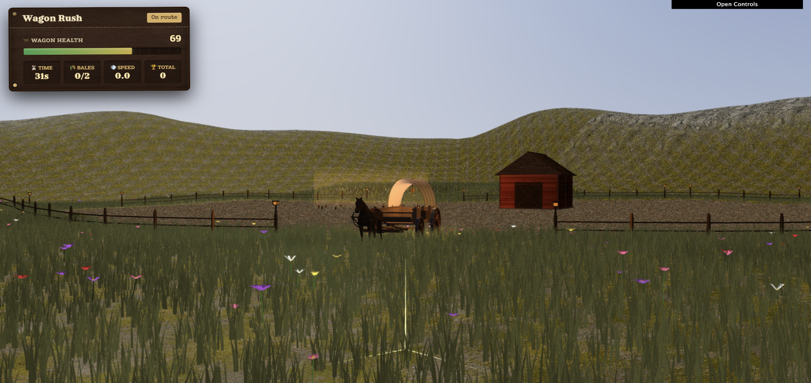
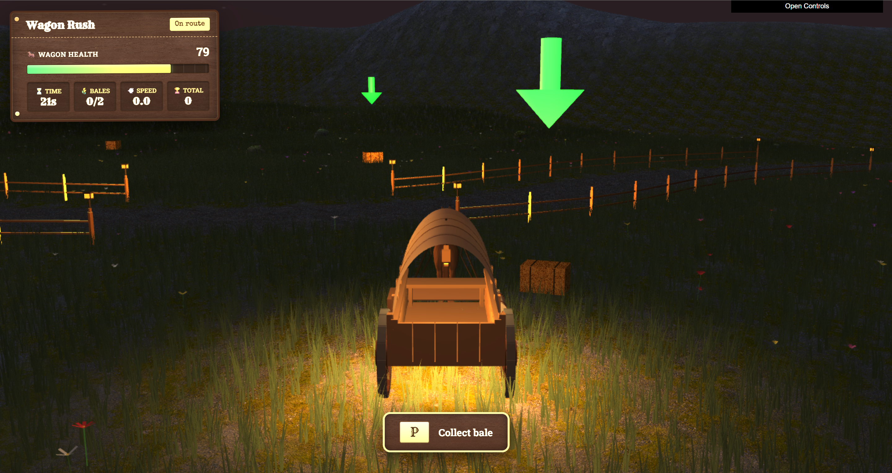
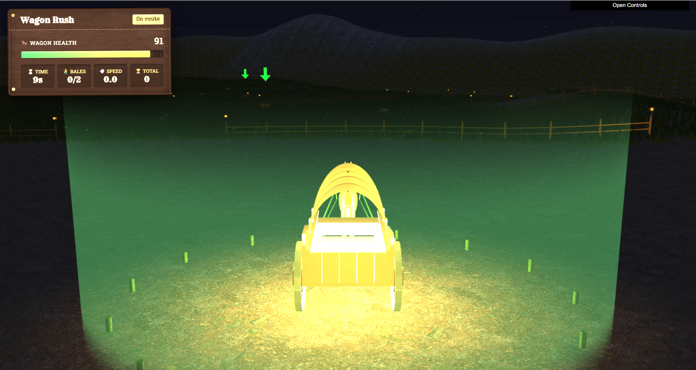
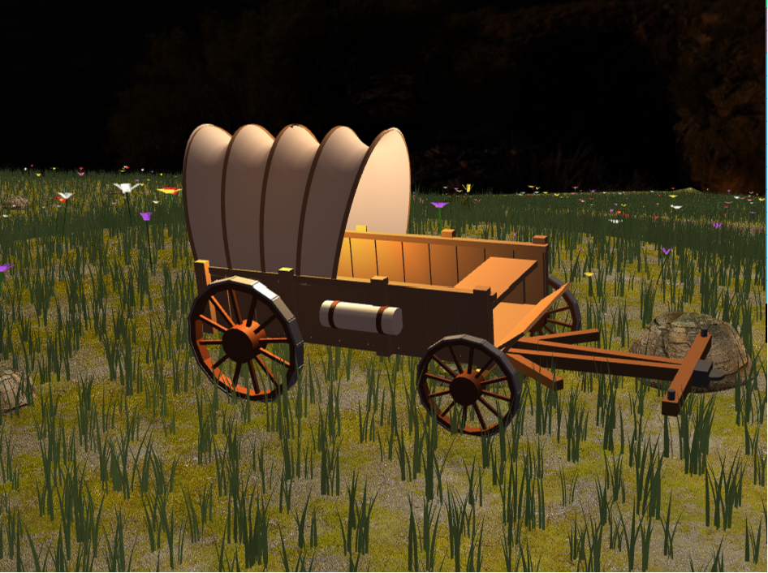
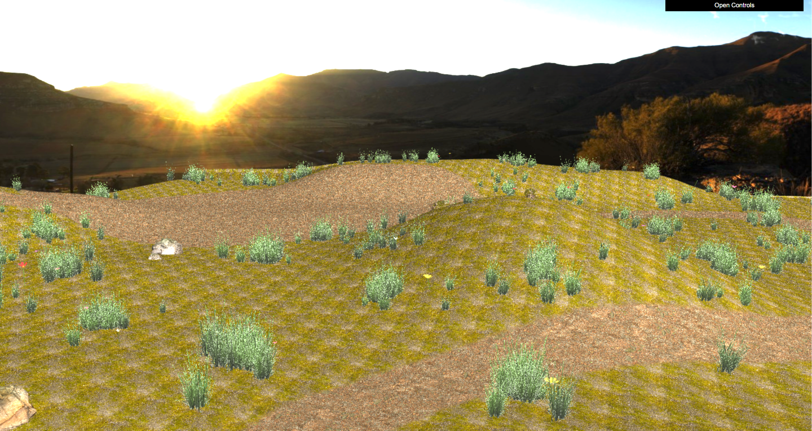
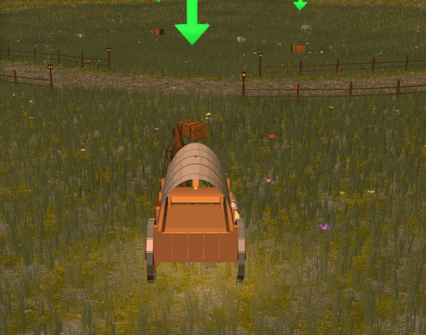

# Wagon Rush

**A 3D survival game built with JavaScript, WebGL and GLSL.**

Drive a horse-drawn wagon through a spring prairie, collect hay bales and return them to the barn to restore your health. Avoid obstacles and survive for as long as you can.



Developed as a group project for **Computer Graphics (Computação Gráfica)** at **FEUP, University of Porto**, 2025/2026 — T04G07.

[Getting started](#getting-started) · [Controls](#controls) · [Graphics and implementation](#graphics-and-implementation) · [Team](#team-and-academic-context)

## Gameplay

Your score is the number of seconds you survive. Health decreases over time, and collisions cause additional damage. Collect up to **two hay bales** at a time and deliver them to the barn: each bale restores **20 HP**, up to the **100 HP** maximum.

- Follow the animated arrows to locate nearby bales.
- Approach a bale and press **P** to collect it.
- Return to the barn's glowing delivery zone and press **L** to unload.
- Watch your health, cargo, speed and survival time in the HUD.

## Screenshots

| Collecting hay at night | The barn delivery zone |
| --- | --- |
|  |  |

| Wagon modelling | Procedural prairie |
| --- | --- |
|  |  |

<details>
<summary>Watch the shader animation preview (GIF, approximately 20 MB)</summary>



</details>

Additional captures are available in [screenshots/](screenshots/). These images include both gameplay and development views; some show earlier debug controls or scene settings.

## Graphics and implementation

| Area | Implementation |
| --- | --- |
| Terrain | Heightmap displacement, procedural outer mountains, road depression, terrain/road texture blending and normal/specular maps. |
| Vegetation | Deterministic, terrain-aware placement of grass and flowers, with wind animation in GLSL shaders. |
| Atmosphere | Procedural sky, day/twilight/night lighting transitions, a textured sun and animated clouds. |
| Wagon | Hierarchical geometry, rotating wheels, a front steering pivot, terrain-following suspension and a loaded horse OBJ with speed-dependent motion. |
| World | Procedural rock morphologies, a barn, and road-mask-driven fences with lanterns. |
| Interaction | Keyboard driving, proximity-based pickup, limited cargo, hay respawning and delivery-based health restoration. |
| Feedback | Collision damage, animated bale arrows, a delivery-zone shader, HUD effects and free/wagon camera modes. |

**Stack:** JavaScript ES modules · WebGL 2 · GLSL · WebCGF 3.0.1 · HTML/CSS · dat.GUI · OBJ assets.

## Getting started

### Requirements

- A desktop browser with **WebGL 2** enabled and a keyboard.
- **Python 3** for the local HTTP server, and **Git** to clone the repositories.
- The course-provided **WebCGF `lib/` directory**, including its shader files and `dat.gui.module.min.js`.

This repository contains the contents of the original `project/` folder at its root. The shared course library is **not included**. The existing module imports expect it in a sibling directory, so use this layout:

```text
workspace/
├── CG-Wagon-Rush/
│   ├── index.html
│   ├── main.js
│   ├── shaders/
│   └── ...
└── lib/
    ├── CGF.js
    ├── dat.gui.module.min.js
    └── CGF/
        └── shaders/
```

### Setup on Windows (PowerShell)

Open a terminal in an empty parent directory, then clone the game:

```powershell
git clone https://github.com/JpMars05/CG-Wagon-Rush.git
```

Copy the complete `lib/` folder from your course checkout into that same parent directory. Alternatively, obtain just the library from the original course repository:

```powershell
git clone --depth 1 --filter=blob:none --sparse https://gitlab.up.pt/meic-cg/cg-2025-2026/t04/cg-t04-g07.git cg-course-runtime
git -C cg-course-runtime sparse-checkout set lib
Copy-Item -Path .\cg-course-runtime\lib -Destination .\lib -Recurse
```

Access to the university GitLab may require your university account or network. Use the matching course library; the version inspected for this portfolio is WebCGF **3.0.1**. On macOS/Linux, use the same directory layout and copy `lib/` with your file manager or `cp -R`.

From the **parent directory containing both `CG-Wagon-Rush/` and `lib/`**, start the server:

```powershell
python -m http.server 8000 --bind 127.0.0.1
```

On Windows, `py -m http.server 8000 --bind 127.0.0.1` also works if Python is registered through the launcher. On macOS/Linux, the command may be `python3`.

Open **[http://localhost:8000/CG-Wagon-Rush/](http://localhost:8000/CG-Wagon-Rush/)**, wait for the scene to finish preparing and click **Start Game**. Stop the server with **Ctrl+C**.

### Troubleshooting

- **Blank scene or `CGF.js` 404:** check that `lib/` is beside `CG-Wagon-Rush/` and serve their parent directory. Copying only `CGF.js` is insufficient; the framework also loads its own shaders.
- **Module, texture or OBJ loading errors:** use the HTTP address above. Opening `index.html` directly through `file://` will not work.
- **Slow loading or low frame rate:** the horse mesh, detailed textures, dense grass and dynamic lights can be demanding. Allow the scene to finish loading and use a browser with hardware acceleration enabled.
- **Fonts differ offline:** the interface requests Google Fonts; the 3D assets are loaded locally.

## Controls

| Input | Action |
| --- | --- |
| **W** | Accelerate forward |
| **S** | Brake / reduce speed |
| **A / D** | Steer left / right while moving |
| **P** | Pick up a nearby hay bale when in range |
| **L** | Deliver carried bales inside the barn delivery zone |
| **Active Camera** in the GUI | Switch between **Free** and **Wagon** cameras |
| **Try Again** | Restart after game over |

The wagon uses forward-only movement. The GUI also exposes wagon-camera settings and gameplay monitors.

## Project structure

```text
CG-Wagon-Rush/
├── index.html          # Start menu, HUD and game-over screen
├── main.js             # WebCGF application entry point
├── MyScene.js          # Scene setup, lighting and gameplay coordination
├── MyInterface.js      # Keyboard input, cameras and dat.GUI
├── environment/        # Terrain, sky objects, vegetation and rocks
├── gameplay/           # Hay bale management and delivery zone
├── wagon/              # Wagon components and horse
├── primitives/         # Reusable geometric primitives
├── structures/         # Barn, fence and hay bale geometry
├── shaders/            # Custom GLSL vertex and fragment shaders
├── objects/            # Horse OBJ mesh
├── textures/           # Colour, normal, specular and height maps
├── styles/             # Menus and HUD styling
├── utils/              # Asset loading, OBJ loading and seeded randomness
└── screenshots/        # Gameplay captures and animation preview
```

## Limitations

- Performance varies with GPU capability, particularly with dense vegetation, transparency and multiple lights.
- Collision volumes approximate the visible geometry around irregular rocks, fences and the barn.
- The course framework must be supplied separately before the game can run.

## Team and academic context

Created by **Gustavo Oliveira**, **João Pedro Sousa** and **Guilherme Nereu** for **L.EIC — Computação Gráfica**, FEUP, **2025/2026**, group **T04G07**.

This is a portfolio copy of the group's work. The [original course repository](https://gitlab.up.pt/meic-cg/cg-2025-2026/t04/cg-t04-g07) remains the source of the academic submission. The snapshot used here is [`8d38e8a`](https://gitlab.up.pt/meic-cg/cg-2025-2026/t04/cg-t04-g07/-/commit/8d38e8acfc12f3de2e9fe89ac4bdb77faa1f9bed). WebCGF is the framework provided by the course.

The import includes only files from `project/`, with revised documentation and a `.gitignore`. A small runtime fix adds the missing `getFlowerPatches()` and `getRockPatches()` accessors in `MyGrass`, which the scene already calls while rebuilding vegetation and rocks. The original 125 MB MP4 is omitted; the screenshots and GIF are retained. Coursework folders and the original repository history are not included.

### AI-use declaration

As documented in the original submission, GitHub Copilot supported short code snippets, while Sonnet and Gemini supported planning, debugging and documentation. The group defined the scene concept, features and implementation decisions, and reviewed, adapted and validated suggestions before inclusion. Testing, visual adjustments and the final submitted version were completed by the group.
